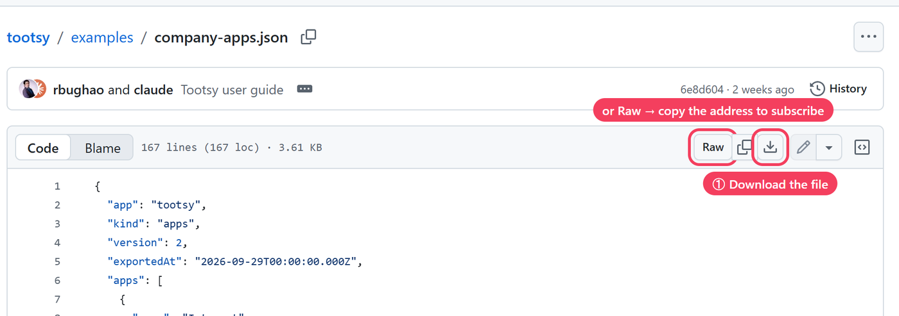
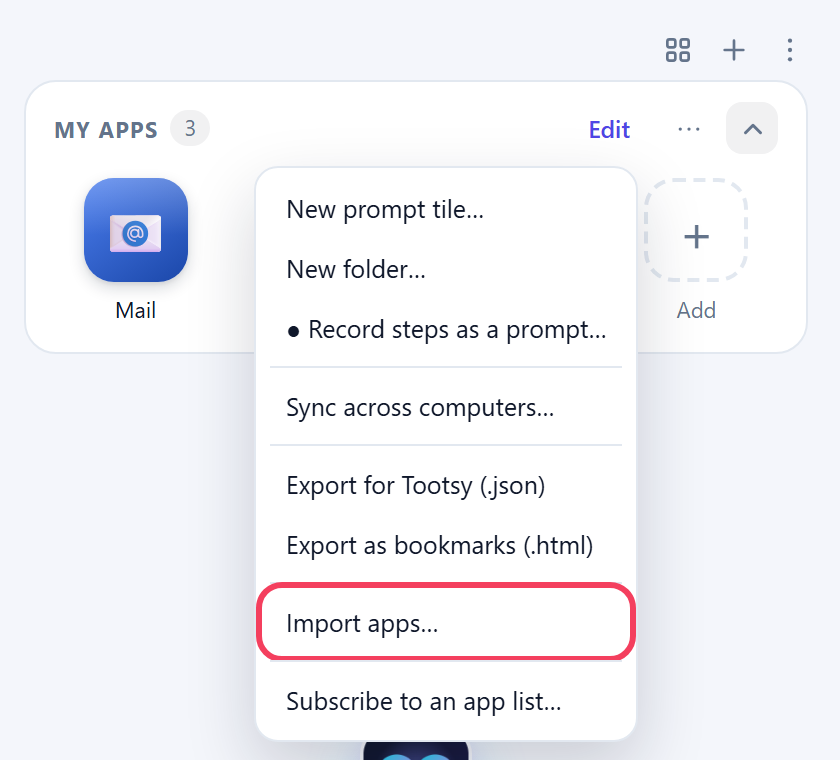
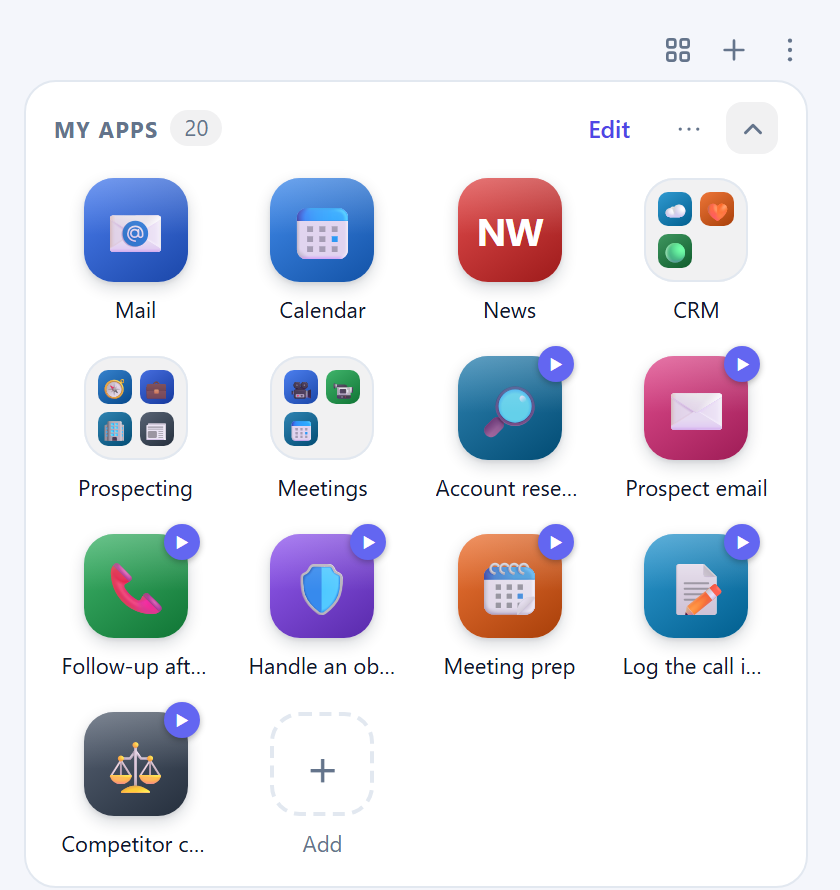
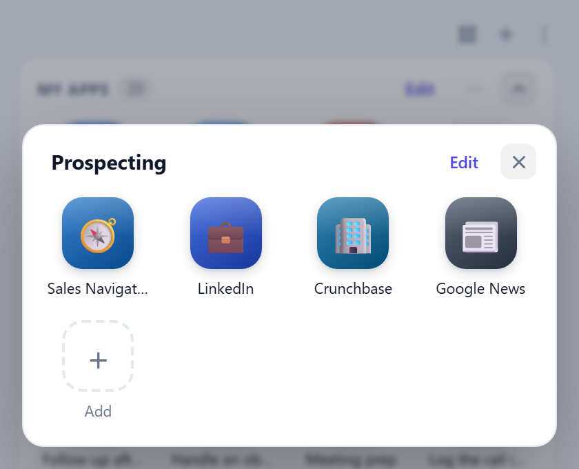
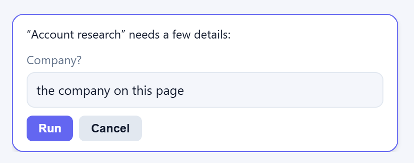

# Tootsy starter packs

Ready-made **My apps** lists for common roles. Each pack is one file holding links to the tools that role uses most, grouped into folders, plus **prompt tiles**. A prompt tile is a saved instruction you run with one tap, such as "Reply to this review" or "Summarise this paper".

Download the pack for your role, import it, and you're set up in a minute. Change anything afterwards: rename, remove, rearrange, or add your company's own tools.

| Pack | For | Link folders | Prompt tiles |
|---|---|---|---|
| [digital-marketing.json](digital-marketing.json) | Digital marketers | Analytics & ads, Create & publish, Check & test (13 links) | SEO check this page · Social posts from page · Competitor teardown · Ad copy variants · Campaign brief · Rewrite in brand voice · Weekly report email |
| [research.json](research.json) | Researchers | Find papers, Data & statistics, Write & cite (12 links) | Summarise this paper · Extract the methods · Compare my sources · Cite this page · Explain simply · Find related work · Literature notes |
| [it-helpdesk.json](it-helpdesk.json) | Helpdesk and IT support | Service status, Admin consoles, Security checks (13 links) | Triage this ticket · Reply to the user · Is it an outage? · Write a KB article · Explain this error · Phishing check · Onboarding checklist |
| [human-resources.json](human-resources.json) | Human resources | Recruiting, People & policy (8 links) | Screen this CV · Write a job ad · Answer from policy · Interview scorecard · 30-60-90 onboarding · Candidate email · Summarise feedback |
| [developers.json](developers.json) | Developers | Code & docs, Handy tools (12 links) | Review this PR · Explain this code · Debug this error · Ask the docs · Write unit tests · Release notes · Regex helper |
| [hotel-front-desk.json](hotel-front-desk.json) | Hotel front desks | Bookings & reviews, Guest help (10 links) | Reply to this review · Translate for a guest · Local recommendations · Guest email · Handle a complaint · Shift handover · Check a flight |
| [finance.json](finance.json) | Finance teams | Markets & rates, Filings & standards, Accounting (9 links) | Summarise this report · Check an invoice · Fill an expense claim · Variance analysis · Convert currency · Month-end checklist · Explain a term |
| [sales.json](sales.json) | Sales teams | CRM, Prospecting, Meetings (10 links) | Account research · Prospect email · Follow-up after a call · Handle an objection · Meeting prep · Log the call in CRM · Competitor compare |

## Add a pack to Tootsy

**1. Download the pack for your role.** Click its file in the table above, then click the **Download** button (⬇) at the top right of the file.

**2. Import it.** Open Tootsy, go to **My apps**, click **⋯** and choose **Import apps…**. Pick the file you downloaded.

**3. That's it.** The pack's link folders and prompt tiles appear in My apps next to your own. Nothing you already have is replaced, and folders with the same name are merged. The ▶ badge marks a prompt tile.

  
  &nbsp;
  

**4. Use it.** Tap a folder to open its links, or tap a prompt tile on the page you're working on. Tiles that need a detail ask for it first, often with a suggested answer you can keep or change.

You can import several packs; a sales manager might add both **Sales** and **Finance**, for example.

### Or subscribe, to get updates automatically

Instead of downloading, you can subscribe to a pack, and Tootsy keeps it up to date when the file changes:

1. Open the pack's file and click **Raw** (marked in the first picture above). Copy the address from the browser's address bar.
2. In Tootsy, go to **My apps → ⋯ → Subscribe to an app list…** (just below Import apps…) and paste it.

A subscribed pack appears as its own read-only section. For safety, prompts from a subscribed list never run hands-free or on a schedule. To edit the tiles, import the file instead.

## How the prompt tiles work

Tap a tile and Tootsy runs its instruction on the page you're looking at. Some tiles fill in details when they run:

| In the instruction | What happens |
|---|---|
| `{{selection}}` | Uses the text you've selected on the page. Select some text first. |
| `{{page}}` | Uses the current page's title and address. |
| `{{ask: Which role?}}` | Asks you before running. A suggested answer may be filled in already. |
| `{{date}}` | Today's date. |

The tiles are safe to try:

- None of them runs hands-free or on a schedule.
- Tiles that fill forms (an expense claim, a CRM entry) show you what they'll type and ask before acting. They never press Submit for you.
- Tiles that write emails open a **draft** in your mail app. You review it and press Send yourself.
- Tiles like "Compare my sources" or "Answer from policy" work on files you've added to Tootsy (**+ → Add files…**).

To change a tile, right-click it (or press and hold) and choose **Edit…**.

## Make it yours

- **Add your company's own tools** (intranet, ticketing system, HR portal) with **+** in My apps. Many packs link to the public sign-in page of popular tools; if your company uses a different address (for example a company Salesforce or Workday address), edit the link.
- **For IT teams:** use a pack as the starting point for your company's list. Edit the file, host it on your intranet, and set it for everyone through browser policy (`appsUrl`). Staff then see it as a locked **company apps** section. See [For IT: manage Tootsy with browser policy](https://github.com/rbughao/tootsy#34-for-it-manage-tootsy-with-browser-policy).

The links point to well-known public websites, as a starting point. They're not endorsements, and Tootsy isn't affiliated with any of them.
